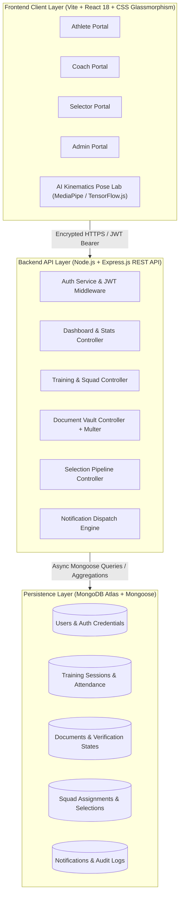

# State Sports Academy (SSA) — Performance Monitoring & Selection Tracking Portal
## Comprehensive Final Project Review & Defense Dossier

---

## 1. Project Overview & Objective

### 1.1 Problem Statement
In traditional state-level sports governance and athletic development programs, talent identification and training administration suffer from critical bottlenecks:
- **Fragmented Record-Keeping:** Athlete progress, attendance, fitness benchmarks, and medical clearances are tracked manually on paper sheets or disconnected spreadsheets, leading to lost records and human errors.
- **Subjective & Unscientific Scouting:** Talent identification during state trials relies heavily on subjective visual observation without quantitative kinematic or biomechanical movement data.
- **Verification Inefficiencies:** Verifying age certificates (e.g., birth certificates, Aadhaar cards) and achievement documentation requires manual physical review, creating trial delays and verification fraud risks.
- **Lack of Transparency in Selections:** Absence of a standardized scoring matrix and candidate nomination pipeline creates scrutiny and lack of accountability in state squad rosters.

### 1.2 Core Objectives
The **State Sports Academy (SSA) Portal** was architected to eliminate these barriers through an enterprise-grade, data-driven sports management ecosystem:
1. **Centralized Lifecycle Management:** Digitalize records for athletes across disciplines (Athletics, Volleyball, Badminton, Swimming, etc.) from registration to state representation.
2. **Objective Biomechanical Movement Assessment:** Embed real-time AI-powered computer vision kinematics inside the web browser to extract joint angles, postural alignment, and movement efficiency without requiring proprietary sensor suits or expensive external hardware.
3. **Transparent 3-Tier Selection Governance:** Enable official State Selectors to scout district athletes, grade standardized performance scorecards, and nominate candidates through an auditable selection workflow (Registered → Shortlisted → Selected).
4. **Verified Document Vault:** Implement a multi-stage document lifecycle allowing athletes to upload digital credentials and coaches/officials to verify or reject them with audit notes.
5. **Real-time Event Notifications:** Dispatch instant in-app alerts whenever documents are evaluated, training sessions are scheduled, or selection decisions are published.

---

## 2. System Architecture & High-Level Workflow

### 2.1 Architectural Flow Diagram (Mermaid)

---

## 3. Detailed Role-Wise Workflows

### 3.1 Athlete Workflow
1. **Registration & Onboarding:** Athlete registers with sport discipline (e.g., Athletics), state/district, gender, contact details, and credentials.
2. **Document Upload to Vault:** Athlete uploads digital proofs (Birth Certificate, Aadhaar Card, Achievement Certificate, Medical Report) via the Document Vault.
3. **Training & Attendance Tracking:** Athlete checks assigned upcoming training sessions scheduled by the coach and views personal attendance percentages.
4. **Biomechanical Self-Assessment:** Athlete launches the **Biomechanical Pose Lab**, activates webcam/video feed, and performs athletic drills to inspect posture alignment, joint angles, and movement form.
5. **Leaderboard & Notifications:** Athlete views district and state rankings on the live leaderboard and receives instant notifications when documents are approved or sessions are updated.

### 3.2 Coach Workflow
1. **Squad Roster Management:** Coach monitors assigned athletes, tracks individual attendance percentages, fitness ratings, and awards bonus points for exemplary discipline.
2. **Session Scheduling:** Coach schedules training sessions specifying sport, date, time slot, venue/ground, and training objectives.
3. **Document Verification:** Coach reviews athlete uploads in the **Document Review Panel**, visually inspects files, and marks them as **Verified** or **Rejected** with feedback notes.
4. **Kinematic Movement Analysis:** Coach evaluates athlete jump angles, knee flexion, hip angles, and kinematic stability using the embedded AI Pose Lab.
5. **Analytics & PDF Export:** Coach inspects squad distributions and exports official PDF roster and performance summaries.

### 3.3 Selector Workflow
1. **Candidate Discovery & Scouting:** Selector accesses the **State Selection Board Hub**, filtering district athletes by sport, gender, and performance benchmarks.
2. **Performance Scorecard Evaluation:** Selector grades athletes across core athletic dimensions: Speed, Stamina, Technical Execution, Tactical Discipline, and Kinematics.
3. **Audit-Driven Selection Pipeline:** Selector promotes candidates through governed stages:
   - `Scouted / Registered` → `Shortlisted` → `Selected for State Squad`.
4. **Official Notification Trigger:** Every selection action automatically issues instant in-app alerts to the athlete and coach, documenting the decision timestamp.

### 3.4 Administrator Workflow
1. **System Governance:** Admin monitors user distribution across all 4 roles, manages user privileges, and inspects system logs.
2. **Audit & Compliance:** Admin reviews system-wide academy reports, verifies regional equity, and oversees document clearance compliance.

---

## 4. Key Novelties & Innovations (What Makes This Project Unique)

| # | Innovation | Traditional Approach | Our Solution & Novelty |
|---|---|---|---|
| **1** | **Browser-Native AI Biomechanical Pose Lab** | Expensive motion-capture sensor suits ($10,000+) or offline manual video markup. | Integrated **MediaPipe / TensorFlow.js** real-time computer vision kinematics directly in the client browser. Calculates real-time joint angles (knee, hip, elbow, trunk flexion) via pure trigonometry without external hardware or cloud GPU costs. |
| **2** | **End-to-End Auditable Selection Pipeline** | Unrecorded verbal trial selections, subjective scorecards, and paper nominations. | Transparent 3-stage candidate pipeline (`Registered` → `Shortlisted` → `Selected`) with structured metric scoring and instant database persistence. |
| **3** | **Integrated Document Vault with Audit Review** | Physical photocopy submission prone to loss, manipulation, and delayed verification. | Encrypted file upload pipeline (Multer + disk storage) with dual-state status flags (`Pending`, `Verified`, `Rejected`) and coach verification feedback notes. |
| **4** | **Role-Adaptive Dynamic Glassmorphic Interface** | Generic static HTML forms or cluttered administrative tables. | Custom CSS dark-glassmorphism design system with role-tailored color accents (Purple Admin, Cyan Selector, Blue Coach, Amber Athlete) and GSAP micro-animations. |
| **5** | **Responsive Cross-Platform Architecture** | Desktop-only dashboards that break or overflow on tablets and mobile screens. | Touch-optimized off-canvas slide-out navigation drawers, backdrop overlays, and mobile-adaptive flex layouts compatible with smartphones. |

---

## 5. Technology Stack & Technical Justifications

### 5.1 Frontend Technologies

#### 1. React 18 (Single Page Application)
- **Why We Chose It:** React's component-driven architecture allows breaking complex dashboards into reusable, modular components (`BiomechanicalPoseLab`, `DocumentVault`, `NotificationBell`, `Leaderboard`, `SelectionPanel`).
- **Why It Matters:** React's virtual DOM reconciliation ensures instantaneous UI updates when filtering rosters, toggling tabs, or receiving notification events without full-page browser reloads.

#### 2. Vite (Build Tool & Dev Environment)
- **Why We Chose It:** Replaced traditional Webpack with Vite.
- **Technical Advantage:** Leverages native ES modules (ESM) to deliver lightning-fast Hot Module Replacement (HMR) (<50ms) and optimized Rollup production bundling with tree-shaking and gzip asset compression.

#### 3. Vanilla CSS + Custom Glassmorphism Design System (No Tailwind)
- **Why We Chose It:** Built with custom CSS custom properties (variables) rather than heavy utility frameworks.
- **Technical Advantage:** Provides 100% fine-grained control over GPU-accelerated styling (`backdrop-filter: blur()`, custom gradients, CSS Grid layouts), eliminates runtime CSS parsing bloat, and delivers a sleek, futuristic dark-neon aesthetic.

#### 4. GSAP (GreenSock Animation Platform)
- **Why We Chose It:** Standard browser CSS transitions lack timeline chaining and precise easing controls for multi-element dashboard entrances.
- **Technical Advantage:** GSAP timelines orchestrate staggered entrances (`stagger: 0.08s`) across stat cards and profile widgets with hardware-accelerated rendering.

#### 5. Google MediaPipe Pose & TensorFlow.js
- **Why We Chose It:** High-performance machine-learning body pose estimation.
- **Technical Advantage:** Runs directly on client hardware via WebAssembly (WASM) and WebGL without streaming high-bandwidth athlete video to external cloud servers, guaranteeing absolute athlete privacy and zero server inference latency.

---

### 5.2 Backend Technologies

#### 1. Node.js & Express.js REST API
- **Why We Chose It:** Asynchronous, non-blocking I/O event loop model.
- **Technical Advantage:** Excels at handling concurrent API requests (polling notifications, file uploads, metric updates) with low memory overhead. Unified JavaScript language across both frontend and backend enables seamless data model sharing.

#### 2. JSON Web Tokens (JWT) & Bcrypt.js
- **Why We Chose It:** Stateless, cryptographically signed authentication.
- **Technical Advantage:** Passwords are salted and hashed using Bcrypt (10 salt rounds) before database storage. JWT tokens encapsulate user ID and role permissions, allowing stateless horizontal scaling without server-side session stores.

#### 3. Multer File Upload Pipeline
- **Why We Chose It:** Robust multipart/form-data handling.
- **Technical Advantage:** Validates file MIME types, enforces upload size limits, and sanitizes file naming conventions before storing athlete verification records.

---

### 5.3 Database & Cloud Technologies

#### 1. MongoDB Atlas & Mongoose ODM
- **Why We Chose It:** Document-oriented NoSQL database.
- **Technical Advantage:** Sports performance metrics, training sessions, and athlete profiles are inherently hierarchical and evolve over time (e.g., varying sport-specific drills). MongoDB's flexible BSON document model allows dynamic nested schemas without brittle SQL table alterations.

#### 2. Render Cloud Hosting
- **Why We Chose It:** Modern cloud platform supporting automated continuous deployment (CI/CD) directly from the GitHub repository (`main` branch).
- **Technical Advantage:** Handles production process management, automatic SSL certificate provisioning, and environment variable isolation.

---

## 6. Key Project Review Questions & Model Answers (Viva / Defense)

### Q1: What is the primary novelty of this portal over existing sports management software?
> **Answer:** "Most current sports portals are passive data repositories—they merely store contact details or match scores. Our portal introduces **active real-time computer vision biomechanics** directly inside the client browser using MediaPipe and TensorFlow.js. It extracts 33 body landmark coordinates in real-time, calculates knee/hip/trunk flexion angles via vector trigonometry, and displays immediate postural feedback during athletic trials—all with zero external sensor hardware and complete athlete privacy."

### Q2: Why did you choose MongoDB instead of a Relational Database like MySQL or PostgreSQL?
> **Answer:** "Athletic records are polymorphic. An Athletics runner tracks 100m sprint times and stride rates, whereas a Swimmer tracks stroke frequency, and a Volleyball player tracks vertical jump angles. MongoDB's document model natively supports polymorphic schema design without complex multi-table joins or sparse tables. Furthermore, athlete document verification histories and notification payloads naturally fit into embedded subdocuments, delivering higher query performance for read-heavy athlete dashboards."

### Q3: How is security and Role-Based Access Control (RBAC) enforced?
> **Answer:** "We enforce security at three levels:
> 1. **Authentication:** Passwords are encrypted with Bcrypt (10 salt rounds). Authentication issues an HMAC-SHA256 signed JSON Web Token (JWT).
> 2. **API Middleware:** Every protected route passes through a JWT authentication middleware that validates token integrity and decodes the user's role.
> 3. **Role Authorization:** Route-specific guards (e.g., `verifyRole(['coach'])` or `verifyRole(['selector'])`) ensure athletes cannot evaluate documents or alter selection states, and selectors cannot schedule coach sessions."

### Q4: How does the AI Biomechanical Analyzer calculate joint angles?
> **Answer:** "MediaPipe Pose outputs 3D coordinates $(x, y, z)$ for 33 body landmarks. To calculate an anatomical joint angle (for example, the knee angle formed by the Hip $A$, Knee $B$, and Ankle $C$), we compute the vectors $\vec{BA} = A - B$ and $\vec{BC} = C - B$. We then calculate the dot product and magnitude to determine the angle in degrees using the standard formula:
> $$\theta = \arccos\left(\frac{\vec{BA} \cdot \vec{BC}}{\|\vec{BA}\| \|\vec{BC}\|}\right) \times \left(\frac{180}{\pi}\right)$$
> This computation executes at 30+ frames per second via client-side WebGL acceleration."

### Q5: What makes the frontend responsive on mobile devices?
> **Answer:** "We implemented an off-canvas drawer navigation architecture. On desktop viewports (>768px), the sidebar is statically positioned. On mobile viewports (≤768px), the sidebar is translated off-canvas (`transform: translateX(-100%) !important`) and controlled via state-driven CSS classes (`.sidebar.open`), a hamburger toggle button in the mobile header, a dedicated 1-tap close button (`×`), and a blurred backdrop overlay."

---

## 7. Summary & Future Scope
- **Current Achievement:** A fully functional, production-deployed portal covering registration, document verification, biometric kinematics, training management, state scouting, and notification dispatch across 4 user roles.
- **Future Enhancements:**
  1. Offline Progressive Web App (PWA) support for rural sports grounds with intermittent internet connectivity.
  2. Integration of video velocity tracking to calculate explosive athletic force and sprint acceleration curves.
  3. Biometric smart-band integration (heart rate, HRV, SpO2) via Web Bluetooth APIs.
